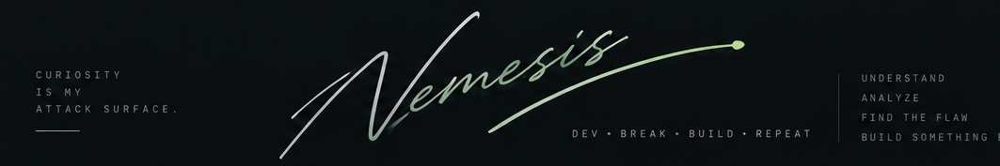

  

  
  
  
  

---

### `> about_me`

A developer and cybersecurity enthusiast interested in how systems work — from web applications and network traffic to digital evidence and system security. I explore, build, and share tools across cybersecurity, forensics, and software development.

- 🔐 Cybersecurity, CTFs, and vulnerability research
- 🔎 Digital forensics, file recovery, and network analysis
- 💻 Web applications and desktop software
- 🐧 Linux, networking, and system internals
- 🧪 Learning through hands-on experiments and open-source projects

> *Understand the system. Find the flaw. Build something better.*

### `> tech_stack`

  

**Security & forensics:** Wireshark · ExifTool · Binwalk · Steghide · StegSeek · TestDisk · PhotoRec · The Sleuth Kit

**Areas of interest:** Web security · Cryptography · Steganography · Network forensics · Reverse engineering · Secure software development

### `> featured_projects`

<table>
  <tr>
    <td width="50%" valign="top">
      <h3>🔎 The Hidden Bytes</h3>
      Browser-based digital forensics, firmware carving, and steganography exploration.
        
      
    </td>
    <td width="50%" valign="top">
      <h3>🌐 ByteShark</h3>
      Network forensics tooling focused on PCAP analysis and traffic investigation.
        
      
    </td>
  </tr>
  <tr>
    <td width="50%" valign="top">
      <h3>💽 CyberForensics Workstation</h3>
      A Windows desktop forensic investigation environment for recovery and data-erasure workflows.
        
      
    </td>
    <td width="50%" valign="top">
      <h3>🧭 VeriScope</h3>
      An AI-assisted fake-news detection project.
        
      
    </td>
  </tr>
</table>

### `> github_activity`

  

  
  

  <i>Dev. Break. Build. Repeat.</i>
   
  Curiosity is my attack surface.
    
  

